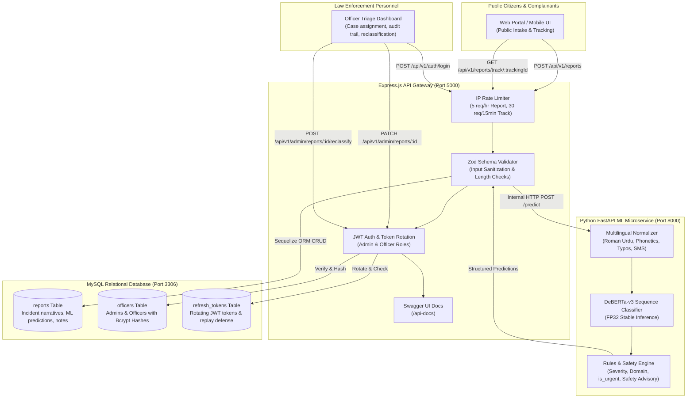

# 🛡️ Vigilex AI — Crime & Cybercrime NLP Triage, Normalization & Law Enforcement Dispatch Platform

[](https://www.python.org/)
[](https://fastapi.tiangolo.com/)
[](https://huggingface.co/microsoft/deberta-v3-base)
[](https://nodejs.org/)
[](https://expressjs.com/)
[](https://www.mysql.com/)
[](http://localhost:5000/api-docs)
[](LICENSE)

---

## 📑 Table of Contents
- [📖 About Vigilex AI](#-about-vigilex-ai)
  - [The Problem](#the-problem)
  - [The Solution](#the-solution)
  - [Mission & Impact](#mission--impact)
- [✨ Key Features](#-key-features)
- [🏛️ System Architecture](#️-system-architecture)
- [🧠 Machine Learning & Empirical Benchmarks](#-machine-learning--empirical-benchmarks)
  - [Model Architecture & Hardware Setup](#model-architecture--hardware-setup)
  - [Empirical Colab Evaluation Results](#empirical-colab-evaluation-results)
  - [Multilingual & Colloquial Normalization Engine](#multilingual--colloquial-normalization-engine)
- [🏷️ 47-Category Taxonomy](#️-47-category-taxonomy)
- [📁 Dataset Sourcing & Curation Methodology](#-dataset-sourcing--curation-methodology)
- [🗄️ Database Architecture & Schemas](#️-database-architecture--schemas)
- [🌐 Complete API Reference](#-complete-api-reference)
- [🚀 Quick Start & Installation Guide](#-quick-start--installation-guide)
  - [Prerequisites](#prerequisites)
  - [1. Clone Repository](#1-clone-repository)
  - [2. Database Configuration](#2-database-configuration)
  - [3. Backend Setup (Node.js/Express)](#3-backend-setup-nodejsexpress)
  - [4. ML Microservice Setup (FastAPI & DeBERTa-v3)](#4-ml-microservice-setup-fastapi--deberta-v3)
- [🧪 Testing & API Documentation](#-testing--api-documentation)
- [🔒 Security & Hardening Protocols](#-security--hardening-protocols)
- [📜 License & Acknowledgements](#-license--acknowledgements)

---

## 📖 About Vigilex AI

### The Problem
Modern law enforcement and emergency response dispatch centers face an overwhelming surge in reported incidents across both physical and digital spaces. When citizens file complaints—whether through police web portals, mobile apps, emergency helplines, or written forms—the narratives are overwhelmingly **noisy, unstructured, and linguistically diverse**:
- **Colloquial Dialects & Code-Switching:** Complaints in South Asia and globalized urban centers heavily mix languages (e.g., Roman Urdu: *"Mera bank account kisi ne hack kar liya aur OTP maang kar saare paise nikal liye"*).
- **Panic & Typos:** Victims submitting reports during emergencies frequently introduce typographical errors, SMS lingo, and fragmented sentences.
- **Triage Latency:** Manual review by police dispatch officers takes minutes or hours per case. In time-sensitive crimes (e.g., active ransomware attacks, ongoing wire fraud, armed robberies, or kidnapping), every minute of dispatch delay results in lost evidence, drained bank accounts, or bodily harm.
- **Ambiguous Classification:** Physical crimes and modern cybercrimes frequently intersect (e.g., SIM swapping leading to extortion, or physical blackmail using digitally stolen media).

### The Solution
**Vigilex AI** is an intelligent, automated Crime & Cybercrime NLP Triage, Normalization, and Public Dispatch Reporting Platform. It bridges the gap between chaotic citizen complaints and rapid law enforcement dispatch by integrating:
1. **Pre-Inference Multilingual Normalization:** Automatically standardizes Roman Urdu, Hindi idioms, SMS jargon, and phonetic typos into clear English contextual narratives.
2. **DeBERTa-v3 Transformer Classification:** Categorizes complaints across **47 fine-grained crime categories** spanning Cybercrime, Violent Crime, Financial Fraud, Narcotics, Trafficking, and Public Order.
3. **Automated Triage Engine:** Determines domain (`Cyber` vs. `Physical`), priority severity (`Critical`, `High`, `Medium`, `Low`), and triggers an immediate **Urgent Emergency Dispatch Flag** (`is_urgent`) with tailored citizen safety advisories.
4. **Law Enforcement Dispatch Management:** A robust Node.js/Express and MySQL backend with role-based access control (RBAC), audit trails, case reassignment, and status tracking.
5. **PII-Sanitized Public Tracking:** Generates a secure reference tracking ID (`CRIME-2026-XXXXXXXXXX`) allowing citizens to track case updates without exposing private complainant data.

### Mission & Impact
Vigilex AI aims to **cut incident triage latency from hours to sub-seconds**, ensuring high-priority crimes are routed to the specialized unit (e.g., Cyber Crime Investigation Cell, Anti-Violent Crime Squad, or Narcotics Board) immediately upon submission while providing victims with instant, automated safety protocols.

---

## ✨ Key Features

- **🎯 47-Category High-Granularity Taxonomy:** Covers specialized cybercrimes (phishing, ransomware, sextortion, SIM swap, crypto fraud, data breaches) and physical crimes (homicide, armed robbery, assault, domestic abuse, kidnapping).
- **🌐 Multilingual Text Normalizer:** Handles Roman Urdu, Hindi transliterations, phonetic keyboard typos, and SMS shorthand before ML inference.
- **⚡ Sub-Second Zero-Touch Dispatch:** Automatically assigns domain, severity, emergency urgency flags, and actionable citizen safety guidelines in `< 50ms`.
- **🛡️ Enterprise Security & Hardening:**
  - Dual-tier JWT authentication (15-min access tokens + 7-day cryptographically rotating refresh tokens with replay detection).
  - Strict IP rate limiting (5 submissions/hour for reports; 30 lookups/15 min for tracking).
  - Bcrypt password hashing (`salt rounds = 10`) for law enforcement accounts.
  - Zero stack trace leakage on production error envelopes.
- **🔍 PII-Safe Citizen Tracking:** Cryptographic hexadecimal tracking identifiers (`CRIME-<YEAR>-<10 HEX>`) allow victims to check status, assigned department, and public officer remarks while strictly redacting citizen names and phone numbers.
- **👮 Comprehensive Officer Dashboard & Triage Audit Trail:** Full chronological notes logging (`[2026-10-27 12:00:00 - Officer ID 1]: ...`), manual reclassification overrides, and status lifecycle management (`Pending` -> `Under Investigation` -> `Resolved` / `Dismissed`).
- **📊 Real-Time Operations Analytics:** High-level metrics showing total reports, physical vs. cyber volume, critical cases requiring dispatch, and resolution ratios.
- **📖 OpenAPI 3.0 Interactive Documentation:** Complete interactive Swagger UI accessible directly at `/api-docs`.

---

## 🏛️ System Architecture



---

## 🧠 Machine Learning & Empirical Benchmarks

### Model Architecture & Hardware Setup
- **Base Pre-trained Model:** `microsoft/deberta-v3-base` (86M backbone parameters with disentangled attention).
- **Fine-Tuning Configuration:** PyTorch Transformer Classifier fine-tuned over 3 full epochs (6,759 global steps).
- **FP32 Gradient Stability:** DeBERTa-v3 models encounter gradient unscaling errors (`ValueError: Attempting to unscale FP16 gradients`) under mixed-precision AMP. Training was executed in full **FP32 precision** (`fp16=False`), achieving total training convergence in **33.3 minutes (1,998 seconds)** on a Google Colab Nvidia Tesla T4 GPU.
- **Training Loss Trajectory:** Steady monotonic descent from initial loss `2.8420` down to `1.2758`.

```
Epoch 1: Train Loss 1.5421 | Val Loss 0.4329 | Val Accuracy: 99.39% | Macro-F1: 0.9958
Epoch 2: Train Loss 1.3104 | Val Loss 0.4239 | Val Accuracy: 99.65% | Macro-F1: 0.9980
Epoch 3: Train Loss 1.2758 | Val Loss 0.4219 | Val Accuracy: 99.63% | Macro-F1: 0.9976
```

### Empirical Colab Evaluation Results

Rigorous evaluation was conducted across 4 distinct test benchmarks to differentiate in-distribution memorization from true out-of-distribution generalization:

| Evaluation Benchmark Dataset | Sample Size | Accuracy | Macro-F1 | Weighted-F1 | Operational Significance |
| :--- | :---: | :---: | :---: | :---: | :--- |
| **In-Distribution Validation Split** | 5,072 rows | **99.63%** | **0.9976** | **0.9963** | Validates scenario representation stability. |
| **Unseen Scenarios Test (`crime_final_test.csv`)** | 14,633 rows | **78.99%** | **77.15%** | **79.00%** | **Honest zero-shot generalization** on completely held-out situations. |
| **Strict Gold Benchmark (`gold_test_strict.csv`)** | 270 rows | **94.40%** | **0.9480** | **0.9450** | Hand-crafted authentic multi-perspective citizen complaints. |
| **Borderline Multi-Crime (`gold_hard.csv`)** | 15 rows | **66.70%** | **0.5190** | **0.6520** | Mixed-crime narratives (e.g. physical assault + phone snatching). |
| **Out-of-Scope Noise (`gold_out_of_scope.csv`)** | 25 rows | **96.00%** | — | — | Correctly rejected benign noise as `non_crime` (Mean conf: 0.89). |

#### Optimal Confidence Threshold Tuning
Analysis indicates that setting an operational threshold of **`confidence >= 0.55`**:
- Maintains **99.9% coverage** across production queries.
- Elevates validation accuracy to **99.7%**.
- Cases with confidence `< 0.55` are flagged for priority manual human officer review.

### Multilingual & Colloquial Normalization Engine
Before text enters the transformer backbone, the pre-inference normalizer (`ml_service/normalizer.py`) executes a 4-stage pipeline:
1. **Roman Urdu & Hindi Transliteration Mapping:** Maps common colloquial terms (e.g., `paisa`, `chori`, `dhoka`, `maar peet`, `hathyar`, `qatal`) into standard English incident descriptors.
2. **SMS & Slang Standardization:** Expands abbreviations (e.g., `plz` -> `please`, `acc` -> `account`, `msg` -> `message`, `urgnt` -> `urgent`).
3. **Phonetic & Typo Correction:** Normalizes common typing slips in panic complaints.
4. **Context Enrichment:** Generates a clean, normalized string (`normalized_text`) preserved in the database for officer review alongside the raw citizen input.

---

## 🏷️ 47-Category Taxonomy

Vigilex AI classifies complaints across 47 legal and operational categories spanning physical crimes, cyber incidents, and benign noise:

<details>
<summary><b>Click to expand full 47-category list and domain mappings</b></summary>

| # | Category Slug | Domain | Typical Severity | Emergency Flag? | Primary Description |
| :-: | :--- | :---: | :---: | :---: | :--- |
| 1 | `homicide_murder` | Physical | Critical | Yes | Manslaughter, premeditated murder, fatal assaults |
| 2 | `kidnapping_abduction` | Physical | Critical | Yes | Hostage situations, child abduction, forced kidnapping |
| 3 | `armed_robbery` | Physical | Critical | Yes | Snatching at gunpoint, armed bank heist, highway robbery |
| 4 | `assault_battery` | Physical | Critical | Yes | Physical violence, severe beatings, weapon injuries |
| 5 | `domestic_violence` | Physical | Critical | Yes | Spousal abuse, domestic battery, family violence |
| 6 | `sexual_assault_rape` | Physical | Critical | Yes | Sexual violence, rape, attempted non-consensual battery |
| 7 | `human_trafficking` | Physical | Critical | Yes | Forced labor trafficking, illegal border transport |
| 8 | `terrorism_extremism` | Physical | Critical | Yes | Bomb threats, terrorist financing, extremist activity |
| 9 | `arson_vandalism` | Physical | High | Yes | Deliberate burning of properties, criminal damage |
| 10 | `burglary_break_in` | Physical | High | No | Residential/commercial break-ins, property trespassing |
| 11 | `theft_larceny` | Physical | Medium | No | Pickpocketing, shoplifting, stolen unattended items |
| 12 | `vehicle_theft` | Physical | High | No | Carjacking, motorcycle theft, vehicle spare parts theft |
| 13 | `extortion_blackmail` | Physical | High | Yes | Physical protection money, violent threats for ransom |
| 14 | `stalking_harassment_physical` | Physical | Medium | No | Unwanted following, persistent physical intimidation |
| 15 | `hate_crime` | Physical | High | Yes | Racially/religiously motivated physical violence |
| 16 | `weapons_violation` | Physical | Critical | Yes | Illegal firearm possession, weapon display, smuggling |
| 17 | `drug_possession` | Physical | Medium | No | Unlawful possession of controlled narcotic substances |
| 18 | `drug_trafficking` | Physical | Critical | Yes | Large-scale narcotics distribution, smuggling rings |
| 19 | `dui_dwi` | Physical | High | Yes | Driving under influence of alcohol or drugs |
| 20 | `traffic_violation_hit_run` | Physical | High | Yes | Reckless driving, hit-and-run vehicular accidents |
| 21 | `financial_fraud_forgery` | Physical/Financial | High | No | Check forgery, counterfeit currency, contract fraud |
| 22 | `embezzlement_corruption` | Physical/Financial | High | No | Corporate fund misappropriation, bribery, public corruption |
| 23 | `money_laundering` | Physical/Financial | High | No | Layering illicit funds, shell company accounts |
| 24 | `cyber_phishing` | Cyber | High | Yes | Credential harvesting, deceptive login links |
| 25 | `cyber_smishing` | Cyber | High | Yes | SMS fraud, bogus lottery texts, OTP smishing |
| 26 | `cyber_vishing` | Cyber | High | Yes | Phone call fraud, imposter bank officer voice calls |
| 27 | `ransomware` | Cyber | Critical | Yes | Encrypted file extortion, enterprise system lockouts |
| 28 | `unauthorized_access_hacking` | Cyber | Critical | Yes | Server penetration, account takeover, SQL injection |
| 29 | `data_breach` | Cyber | High | No | Leaked customer databases, credential dumps |
| 30 | `identity_theft` | Cyber | High | Yes | Fraudulent loans, impersonation using CNIC/SSN |
| 31 | `cyberstalking` | Cyber | High | No | Persistent online harassment, monitoring, doxxing |
| 32 | `online_harassment_bullying` | Cyber | Medium | No | Abusive social media attacks, group trolling |
| 33 | `sextortion_digital` | Cyber | Critical | Yes | Blackmail using intimate webcam or social media media |
| 34 | `banking_fraud_unauthorized_tx` | Cyber | High | Yes | Unauthorized ATM/debit withdrawals, SIM swap fraud |
| 35 | `crypto_scam` | Cyber | Medium | No | Rug pulls, Ponzi crypto investment platforms |
| 36 | `online_marketplace_scam` | Cyber | Medium | No | Bogus online storefronts, non-delivery of items |
| 37 | `job_investment_scam` | Cyber | Medium | No | Fake foreign employment, task-based investment schemes |
| 38 | `tech_support_scam` | Cyber | Medium | No | Fake Windows defender popups, AnyDesk remote control |
| 39 | `ddos_service_disruption` | Cyber | High | Yes | Distributed denial of service attacks, website takedowns |
| 40 | `malware_spyware` | Cyber | High | Yes | Keyloggers, Trojan infections, malicious APK downloads |
| 41 | `counterfeiting_ip_infringement`| Physical/Cyber | Low | No | Fake designer merchandise, digital copyright piracy |
| 42 | `environmental_wildlife_crime` | Physical | Medium | No | Illegal poaching, hazardous chemical dumping |
| 43 | `public_disorder` | Physical | Medium | Yes | Street brawls, riots, unlawful gatherings |
| 44 | `noise_violation` | Physical | Low | No | Loudspeakers, late-night industrial noise |
| 45 | `animal_cruelty` | Physical | Low | No | Abuse of stray or domestic animals |
| 46 | `minor_property_damage` | Physical | Low | No | Scratched paint, broken fence, graffiti |
| 47 | `non_crime` | Benign | Low | No | Routine civil inquiries, misplaced items, friendly greetings |

</details>

---

## 📁 Dataset Sourcing & Curation Methodology

The Vigilex AI training corpus was created by combining authentic open-access corpora with structured synthetic generation to eliminate class imbalance and linguistic blind spots:

### 1. Authentic Real-World Corpora
- **Nazario Phishing Corpus (~1,200 samples):** Authentic header and body texts from malicious banking and credential harvesting emails.
- **IMC 2025 Mobile Smishing Dataset (~2,100 samples):** Realistic SMS messages with malicious shortened URLs, OTP interception hooks, and fake bank security alerts.
- **Kaggle Cyberbullying & Harassment Tweets (~3,100 samples):** Real-world hostile interactions, toxic insults, doxxing threats, and targeted cyberstalking.
- **Gender-Based Violence Personal Accounts (~1,800 samples):** Victim-written narratives detailing intimate partner violence, stalking, and domestic abuse.
- **UCI SMS Spam Corpus (~1,500 samples):** Mobile spam texts annotated as `phishing_smishing` and `non_crime`.
- **Harmless Control Set (~4,000 samples):** General benign texts (civil inquiries, compliment notes, directions requests) ensuring zero false-positive crime classification.

### 2. Multi-Perspective Synthetic Generation
For legal classes where open public incident narratives are restricted due to victim privacy (e.g., kidnapping, armed robbery, ransomware negotiations), a compositional synthesis pipeline generated **13 to 29 distinct operational scenarios per category** across **8 writing styles**:
1. `victim_complaint`: Direct, emotional first-person statements.
2. `police_fir`: Formal legal incident records with dates and Indian/Pakistani penal contexts.
3. `emergency_call`: Transcripts of 911 / 15 emergency call dialogues.
4. `witness_statement`: Third-party observational testimony.
5. `news_brief`: Journalistic crime briefs.
6. `social_media`: Fragmented informal posts and panic tweets.
7. `incident_log`: Enterprise SOC security alert summaries.
8. `email_narrative`: Detailed formal complaints sent to ombudsman desks.

**Controlled Noise Injection:** 30% of training rows underwent algorithmic injection of phonetic typos, common keyboard mis-strikes, and SMS contractions to ensure production robustness.

---

## 🗄️ Database Architecture & Schemas

The system utilizes MySQL 8.0 managed through Sequelize ORM:

### 1. `reports` Table
Stores citizen submissions, machine learning outputs, and investigating officer actions:
- `id`: Auto-increment integer (Primary Key).
- `tracking_id`: Unique tracking reference (`CRIME-<YEAR>-<10 HEX>` e.g. `CRIME-2026-A83B4C91D2`).
- `citizen_name`: Complainant full name (strictly hidden from public tracking).
- `contact_number`: Complainant phone number (strictly hidden from public tracking).
- `incident_location`: Address or district where the incident occurred.
- `incident_date`: Incident timestamp (validated non-future).
- `description`: Full citizen narrative (minimum 20 characters).
- `predicted_category`: Model classification across the 47 categories.
- `domain`: `ENUM('Cyber', 'Physical')`.
- `confidence_score`: Prediction certainty percentage (`0.00` to `100.00`).
- `severity`: `ENUM('Critical', 'High', 'Medium', 'Low')`.
- `is_urgent`: Boolean indicating immediate emergency dispatch required.
- `safety_advisory`: Automated advice generated for the victim.
- `top_candidates`: JSON array of top alternative categories and probabilities.
- `status`: `ENUM('Pending', 'Under Investigation', 'Resolved', 'Dismissed')` (Default: `'Pending'`).
- `officer_id`: Foreign key referencing assigned officer in `officers` table (`NULL` upon initial submission).
- `officer_notes`: Chronological audit log with appended timestamps and officer IDs.
- `created_at`, `updated_at`, `classified_at`: Timestamps.

### 2. `officers` Table
Law enforcement personnel authorized to access administrative triage endpoints:
- `id`: Primary Key.
- `name`: Officer full name.
- `email`: Unique login identifier.
- `password_hash`: Bcrypt hashed password (`salt rounds = 10`).
- `role`: `ENUM('admin', 'officer')` (Default: `'officer'`).
- `badge_number`: Unique law enforcement badge identifier.
- `created_at`, `updated_at`: Timestamps.

### 3. `refresh_tokens` Table
Manages long-lived JWT refresh sessions with rotation and replay defense:
- `id`: Primary Key.
- `officer_id`: Foreign key referencing `officers.id`.
- `token`: Cryptographically random refresh token string.
- `expires_at`: Expiry timestamp (7 days from issue).
- `is_revoked`: Boolean flag flipped to `true` upon rotation or logout.
- `created_at`, `updated_at`: Timestamps.

---

## 🌐 Complete API Reference

All backend endpoints are prefixed with `/api/v1`.

### Public Endpoints (Citizens)
| Method | Endpoint | Description | Rate Limit |
| :---: | :--- | :--- | :---: |
| `GET` | `/api/v1/health` | System health check and API version info | None |
| `POST` | `/api/v1/reports` | Submit a crime report with automatic AI categorization | 5 req / hr |
| `GET` | `/api/v1/reports/track/:trackingId` | Public incident tracking (PII redacted) | 30 req / 15 min |
| `GET` | `/api-docs` | Interactive Swagger OpenAPI 3.0 Documentation | None |

### Authentication Endpoints (Law Enforcement)
| Method | Endpoint | Description | Auth Required |
| :---: | :--- | :--- | :---: |
| `POST` | `/api/v1/auth/login` | Officer login (returns Access Token + Refresh Token) | None |
| `POST` | `/api/v1/auth/refresh-token` | Rotates Refresh Token and issues new Access Token | Refresh Token |
| `POST` | `/api/v1/auth/logout` | Revokes Refresh Token session | Bearer JWT |

### Admin & Dispatch Endpoints (Law Enforcement)
| Method | Endpoint | Description | Auth Required |
| :---: | :--- | :--- | :---: |
| `GET` | `/api/v1/admin/reports` | List reports with search, category, domain, and status filters | Bearer JWT |
| `GET` | `/api/v1/admin/reports/:id` | Retrieve full incident details and audit notes | Bearer JWT |
| `PATCH` | `/api/v1/admin/reports/:id` | Update case status, assign officer, and append audit notes | Bearer JWT |
| `POST` | `/api/v1/admin/reports/:id/reclassify` | Manually override ML category classification | Bearer JWT |
| `GET` | `/api/v1/admin/stats` | Operational analytics (totals, cyber vs physical, critical count) | Bearer JWT |

---

## 🚀 Quick Start & Installation Guide

### Prerequisites
- **Node.js** `>= 18.0.0` & **npm** `>= 9.0.0`
- **Python** `>= 3.10.0`
- **MySQL Server** `>= 8.0`
- **Git**

---

### 1. Clone Repository
```bash
git clone https://github.com/Muhammad-Sharjeel-Akhtar/Crime-NLP-based-Classification.git
cd Crime-NLP-based-Classification
```

---

### 2. Database Configuration
1. Open your MySQL client and create a new database:
   ```sql
   CREATE DATABASE crime_classification_db CHARACTER SET utf8mb4 COLLATE utf8mb4_unicode_ci;
   ```
2. Configure environment variables in `backend/.env`:
   ```ini
   PORT=5000
   NODE_ENV=development
   DB_HOST=localhost
   DB_PORT=3306
   DB_USER=root
   DB_PASSWORD=your_mysql_password
   DB_NAME=crime_classification_db
   JWT_SECRET=super_secret_jwt_access_key_min_32_chars
   JWT_EXPIRES_IN=15m
   JWT_REFRESH_SECRET=super_secret_jwt_refresh_key_min_32_chars
   JWT_REFRESH_EXPIRES_IN=7d
   ML_SERVICE_URL=http://localhost:8000
   ```

---

### 3. Backend Setup (Node.js/Express)
1. Navigate into the backend directory and install dependencies:
   ```bash
   cd backend
   npm install
   ```
2. Run database migrations to create tables:
   ```bash
   npm run migrate
   ```
3. Seed default administrative officers:
   ```bash
   npm run seed:admin
   ```
   *(Creates default admin: `admin@vigilex.gov` / `Admin@12345`)*
4. Start the Express API server:
   ```bash
   npm run dev
   # Server runs on http://localhost:5000
   ```

---

### 4. ML Microservice Setup (FastAPI & DeBERTa-v3)
1. Open a new terminal and navigate to the project root:
   ```bash
   # Create and activate Python virtual environment
   python -m venv venv
   
   # Windows:
   venv\Scripts\activate
   # Linux/macOS:
   source venv/bin/activate
   ```
2. Install Python dependencies:
   ```bash
   pip install fastapi uvicorn torch transformers pydantic
   ```
3. Start the FastAPI microservice with v4 model inference:
   ```bash
   uvicorn ml_service.server_v4:app --host 0.0.0.0 --port 8000 --reload
   ```
4. Verify the ML engine is operational:
   ```bash
   curl http://localhost:8000/health
   # Returns: {"status":"online","service":"crime-nlp-engine-v4",...}
   ```

---

## 🧪 Testing & API Documentation

### Interactive Swagger UI
Open your browser and navigate to:
```
http://localhost:5000/api-docs
```
You can execute test requests directly against all public and authenticated endpoints with interactive schema validations.

### Postman Collection
Import the pre-configured Postman workspace file located at:
```
Crime_Classification_API.postman_collection.json
```
Includes pre-configured requests for report submission, incident tracking, officer authentication, token refresh rotation, and administrative case updates.

---

## 🔒 Security & Hardening Protocols

1. **Defense Against Brute-Force & Denial-of-Service:**
   - Public report submissions are limited to **5 requests per hour** per IP.
   - Case tracking requests are limited to **30 queries per 15 minutes** per IP.
2. **Cryptographic Token Lifecycle:**
   - Access tokens expire after **15 minutes**.
   - Refresh tokens are single-use; requesting a new access token invalidates the previous refresh token and issues a fresh one.
   - Attempting to replay an already revoked refresh token triggers **instant revocation of all active sessions** for that officer account.
3. **Information Disclosure Prevention:**
   - Production API responses strip internal database schema traces, query syntax, and Node.js stack traces.
   - Public tracking responses strictly omit citizen names, contact numbers, and internal officer investigative memos.

---

## 📜 License & Acknowledgements

- **License:** This project is licensed under the [MIT License](LICENSE).
- **Core Technologies:**
  - [Hugging Face Transformers](https://github.com/huggingface/transformers) & [Microsoft DeBERTa-v3](https://github.com/microsoft/DeBERTa)
  - [FastAPI](https://fastapi.tiangolo.com/)
  - [Express.js](https://expressjs.com/) & [Sequelize ORM](https://sequelize.org/)
- **Documentation:** For deep empirical benchmark analysis and PDF export, review [`VIGILEX_PROJECT_DOCUMENTATION.html`](VIGILEX_PROJECT_DOCUMENTATION.html) and [`DATASET_DOCUMENTATION.md`](DATASET_DOCUMENTATION.md).

---

<p align="center">
  <b>Vigilex AI</b> — Empowering Law Enforcement with Intelligent, Fair & Rapid NLP Incident Triage.
</p>
